  
  
  
  

<i>The runbooks we actually use to run our validators, written down so you can use them too.</i>

 

## 🍄 Networks

  
  
  
  

| Network | Chains | What's covered |
|---|---|---|
| 🟣 [**Celestia**](./celestia/) | `celestia` · `mocha-5` | Consensus node · Validator · **Fibre server** · Upgrades & signalling · Cheat sheet |
| ⚪ [**Axelar**](./axelar/) | `axelar-dojo-1` | Full node · Validator · **tofnd + vald** · Broadcaster · **EVM chain maintainers** · Cheat sheet |
| 🔴 [**Akash**](./akash/) | `akashnet-2` | Full node · Validator (`validator.json`) · Upgrades · Cheat sheet |
| 🟠 [**Shentu**](./shentu/) | `shentu-2.2` | Full node · Validator (`validator.json`) · Upgrades · Cheat sheet |

Axelar, Akash and Shentu guides cover <b>mainnet only</b>. Celestia covers both mainnet and the Mocha testnet.

 

## 🧭 How these guides are written

| | Principle |
|---|---|
| 🔀 | **One runbook, two networks.** You set `CHAIN_ID` once and every command works for both mainnet and testnet. |
| 📌 | **Pinned versions.** Each guide states which release it was checked against, and the table in each network hub stays current. |
| 🔐 | **Safety first.** Double-signing and key-handling warnings come *before* the command that could hurt you. |
| 📎 | **Sourced.** Every network-specific value links back to the official docs or release notes. When they disagree, the official source wins. |

> [!IMPORTANT]
> Chains move quickly. Before running anything on mainnet, compare versions, hashes and endpoints with the official documentation linked in each guide.

 

## 🤝 Contributing

Did you find a stale version, a broken command or a better way to do something? Open an issue or a PR, or write to **hello@mushcrypto.xyz**.

