[← 02 Full node](./02-full-node.md) · **03 Validator** · [04 Maintenance →](./04-maintenance.md)

---

> [!CAUTION]
> **Double signing on Akash = 5% slash + permanent tombstone.** Never run the same `priv_validator_key.json` on two machines.

```bash
source $HOME/.akash-env
```

## 1. Wallet

```bash
akash keys add $WALLET --keyring-backend $KEYRING_BACKEND            # new: save the mnemonic offline
# akash keys add $WALLET --recover --keyring-backend $KEYRING_BACKEND  # restore

WALLET_ADDR=$(akash keys show $WALLET -a --keyring-backend $KEYRING_BACKEND)
VALOPER=$(akash keys show $WALLET --bech val -a --keyring-backend $KEYRING_BACKEND)
echo "export WALLET_ADDR=$WALLET_ADDR" >> $HOME/.akash-env
echo "export VALOPER=$VALOPER"         >> $HOME/.akash-env
```

Fund the address. The technical minimum is ~2 AKT (1 to stake, 1 for fees), but entering the **top 100** takes far more. Check the current threshold on an explorer.

```bash
akash q bank balances $WALLET_ADDR
```

## 2. Back up the consensus key

```bash
cp $DAEMON_HOME/config/priv_validator_key.json $HOME/priv_validator_key.akash.backup.json
chmod 600 $HOME/priv_validator_key.akash.backup.json
```

Move it off the server.

## 3. `validator.json`

Akash runs Cosmos SDK 0.53, so `create-validator` takes a **JSON file**.

```bash
cat > $HOME/validator.json <<EOF
{
  "pubkey": $(akash tendermint show-validator --home $DAEMON_HOME),
  "amount": "1000000uakt",
  "moniker": "$MONIKER",
  "identity": "<keybase-id>",
  "website": "<https://your-website>",
  "security": "<security-contact-email>",
  "details": "<short description>",
  "commission-rate": "0.05",
  "commission-max-rate": "0.20",
  "commission-max-change-rate": "0.01",
  "min-self-delegation": "1"
}
EOF
jq . $HOME/validator.json
```

> [!IMPORTANT]
> The chain enforces a **minimum commission of 5%**, so `commission-rate` must be **≥ 0.05**. `commission-max-rate` and `commission-max-change-rate` can never be changed later.

## 4. Create

```bash
akash tx staking create-validator $HOME/validator.json \
  --from $WALLET --chain-id $CHAIN_ID --keyring-backend $KEYRING_BACKEND $GAS -y
```

## 5. Verify

```bash
akash q staking validator $VALOPER | grep -E "moniker|status|jailed|tokens"
curl -s localhost:26657/status | jq '.result.validator_info.voting_power'
```

`BOND_STATUS_BONDED` with a `voting_power` above zero means you are in the active set and signing.

## 6. Stay out of jail

| Rule | Value |
|---|---|
| Window | 10 000 blocks |
| Must sign | **≥ 5%**, so missing 9 500+ jails you |
| Downtime jail | 10 min + 0.01% slash |
| Double sign | 5% + tombstone |

```bash
akash q slashing params
akash q slashing signing-info $(akash tendermint show-validator --home $DAEMON_HOME)

akash tx slashing unjail --from $WALLET --chain-id $CHAIN_ID \
  --keyring-backend $KEYRING_BACKEND $GAS -y
```

## 7. Edit, delegate, withdraw

```bash
akash tx staking edit-validator --new-moniker="<new-moniker>" --website="<https://your-website>" \
  --from $WALLET --chain-id $CHAIN_ID --keyring-backend $KEYRING_BACKEND $GAS -y

akash tx staking delegate $VALOPER 1000000uakt \
  --from $WALLET --chain-id $CHAIN_ID --keyring-backend $KEYRING_BACKEND $GAS -y

akash tx distribution withdraw-rewards $VALOPER --commission \
  --from $WALLET --chain-id $CHAIN_ID --keyring-backend $KEYRING_BACKEND $GAS -y
```

> [!TIP]
> To keep the key off the validator host, Akash documents a [TMKMS setup](https://akash.network/docs/node-operators/validators/tmkms-stunnel/).

---

[← 02 Full node](./02-full-node.md) · **03 Validator** · [04 Maintenance →](./04-maintenance.md)
