[← 04 Maintenance](./04-maintenance.md) · **05 Cheat sheet** · [Akash hub ↑](./README.md)

---

Every command assumes `source $HOME/.akash-env`.

## 🩺 Node

```bash
curl -s localhost:26657/status | jq '.result.sync_info | {latest_block_height, catching_up}'
curl -s localhost:26657/net_info | jq '.result.n_peers'
curl -s localhost:26657/status | jq '.result.validator_info'
akash version
akash comet show-node-id --home $DAEMON_HOME
journalctl -u akash -f -o cat
sudo systemctl restart akash
```

## 👛 Wallet

```bash
akash keys list --keyring-backend $KEYRING_BACKEND
akash q bank balances $WALLET_ADDR
akash tx bank send $WALLET <to> 1000000uakt --chain-id $CHAIN_ID \
  --keyring-backend $KEYRING_BACKEND $GAS -y
```

## 🛡️ Validator

```bash
akash tx staking create-validator $HOME/validator.json --from $WALLET \
  --chain-id $CHAIN_ID --keyring-backend $KEYRING_BACKEND $GAS -y

akash q staking validator $VALOPER
akash q slashing signing-info $(akash tendermint show-validator --home $DAEMON_HOME)

akash tx slashing unjail --from $WALLET --chain-id $CHAIN_ID \
  --keyring-backend $KEYRING_BACKEND $GAS -y

akash tx distribution withdraw-rewards $VALOPER --commission --from $WALLET \
  --chain-id $CHAIN_ID --keyring-backend $KEYRING_BACKEND $GAS -y

akash tx staking delegate $VALOPER 1000000uakt --from $WALLET \
  --chain-id $CHAIN_ID --keyring-backend $KEYRING_BACKEND $GAS -y
```

## 🗳️ Governance & upgrades

```bash
akash q gov proposals --proposal-status voting-period
akash tx gov vote <id> yes --from $WALLET --chain-id $CHAIN_ID \
  --keyring-backend $KEYRING_BACKEND $GAS -y            # yes | no | no_with_veto | abstain
akash q upgrade plan
```

## 📁 Files

| Path | What |
|---|---|
| `~/.akash/config/priv_validator_key.json` | 🔑 consensus key, **never run it in two places** |
| `~/.akash/data/priv_validator_state.json` | last signed height, carry it with the key |
| `~/.akash/config/app.toml` | gas price, pruning, API/gRPC |
| `~/.akash/config/config.toml` | P2P, RPC, state sync, Prometheus |
| `~/.akash/wasm/` | CosmWasm contracts, not cleared by `unsafe-reset-all` |
| `$HOME/validator.json` | create-validator parameters |

---

[← 04 Maintenance](./04-maintenance.md) · **05 Cheat sheet** · [Akash hub ↑](./README.md)


