This is a runbook for **Akash mainnet** (`akashnet-2`). It takes you from a bare server to a signing validator.

> [!NOTE]
> Checked on **2026-10-19** against the official [`meta.json`](https://raw.githubusercontent.com/akash-network/net/main/mainnet/meta.json), the [Akash node docs](https://akash.network/docs/node-operators/) and live chain parameters.

## 🗺️ The path

| Step | Guide | What you get |
|:---:|---|---|
| **01** | [Requirements & install](./01-requirements-install.md) | Server, firewall, the `akash` binary, network variables |
| **02** | [Full node](./02-full-node.md) | A synced node under systemd |
| **03** | [Validator](./03-validator.md) | A bonded validator created from `validator.json` |
| **04** | [Maintenance](./04-maintenance.md) | Upgrades, monitoring, migration |
| **05** | [Cheat sheet](./05-cheatsheet.md) | Every command on one page |

## 📋 Network parameters

| | |
|---|---|
| Chain ID | `akashnet-2` |
| Binary | `akash`, **`v2.1.0`** (the version recommended in `meta.json`) |
| Cosmos SDK / CometBFT | `v0.53` / `v0.38` |
| Home | `~/.akash` |
| Denom | `uakt` (1 AKT = 1 000 000 uakt) |
| Min gas price | `0.00025uakt` fixed minimum. The docs use `--gas-prices 0.025uakt` |
| Active set | **100** validators |
| Min commission | **5%** |
| Unbonding | 21 days |
| Downtime | Sign **≥ 5%** of a **10 000**-block window, or get jailed for 10 min + 0.01% slash |
| Double sign | **5% slash** + tombstone |
| Genesis | [`net/mainnet/genesis.json`](https://raw.githubusercontent.com/akash-network/net/main/mainnet/genesis.json) |
| Snapshots | [snapshots.akash.network](https://snapshots.akash.network/akashnet-2/latest) · [Polkachu](https://polkachu.com/tendermint_snapshots/akash) |
| Explorers | [Mintscan](https://www.mintscan.io/akash) · [ping.pub](https://ping.pub/akash) · [EZStaking](https://ezstaking.app/akash) |

<b>Public endpoints</b>

| RPC | gRPC |
|---|---|
| `https://akash-rpc.polkachu.com` | `akash-grpc.polkachu.com:12890` |
| `https://akash-rpc.publicnode.com:443` | `akash-grpc.publicnode.com:443` |
| `https://rpc-akash.ecostake.com:443` | `akash.lavenderfive.com:443` |

> [!TIP]
> Releases `v2.1.1` and `v2.1.2` exist, but `meta.json` still recommends `v2.1.0`, and that is what the network runs. Follow `meta.json` and the announcements in the validator channels.

<a href="./01-requirements-install.md"><b>Start with step 01 →</b></a>

