[← 02 Full node](./02-full-node.md) · **03 Validator** · [04 External chains →](./04-external-chains.md)

---

> [!CAUTION]
> An Axelar validator has **four secrets**. Losing any of them is painful, and leaking one is worse:
> | Secret | Where | Why it matters |
> |---|---|---|
> | `validator` mnemonic | axelard keyring | Owns the stake |
> | `broadcaster` mnemonic | axelard keyring | Pays for and sends vald's votes |
> | Consensus key | `~/.axelar/config/priv_validator_key.json` | Signs blocks. **Two copies running = double sign (2% + tombstone)** |
> | tofnd mnemonic | `~/.tofnd` | Your share of the **threshold keys** that secure cross-chain assets |

```bash
source $HOME/.axelar-env
```

## 1. tofnd: create the mnemonic

```bash
tofnd -m create -d $TOFND_HOME
cat $TOFND_HOME/export          # write it down offline
rm $TOFND_HOME/export
```

> [!NOTE]
> Restoring an existing tofnd instead? Use `tofnd -m import -d $TOFND_HOME`. It prompts for the keyring password and the mnemonic.

## 2. Accounts: `validator` and `broadcaster`

```bash
axelard keys add validator   --home $AXELAR_HOME      # save the mnemonic
axelard keys add broadcaster --home $AXELAR_HOME      # save the mnemonic
# restore instead: add --recover

VALOPER=$(axelard keys show validator --bech val -a --home $AXELAR_HOME)
VALIDATOR_ADDR=$(axelard keys show validator -a --home $AXELAR_HOME)
BROADCASTER_ADDR=$(axelard keys show broadcaster -a --home $AXELAR_HOME)
cat >> $HOME/.axelar-env <<EOF
export VALOPER=$VALOPER
export VALIDATOR_ADDR=$VALIDATOR_ADDR
export BROADCASTER_ADDR=$BROADCASTER_ADDR
EOF
```

Use the **same password** you put in `/etc/axelar/keyring.env`. The axelard keyring, tofnd and vald all read it.

## 3. Fund both accounts

| Account | Needs |
|---|---|
| `validator` | Your self-delegation plus fees. Entering the **top 75** takes far more than the minimum, so check the threshold on an explorer |
| `broadcaster` | **≥ 5 AXL** at all times. It pays for every vote and heartbeat |

```bash
axelard q bank balances $VALIDATOR_ADDR
axelard q bank balances $BROADCASTER_ADDR
```

## 4. Back up the consensus key

```bash
cp $AXELAR_HOME/config/priv_validator_key.json $HOME/priv_validator_key.axelar.backup.json
chmod 600 $HOME/priv_validator_key.axelar.backup.json
```

## 5. systemd: tofnd and vald

```bash
sudo tee /etc/systemd/system/tofnd.service > /dev/null <<EOF
[Unit]
Description=tofnd (Axelar threshold signing)
After=network-online.target

[Service]
User=$USER
EnvironmentFile=/etc/axelar/keyring.env
ExecStart=/usr/bin/sh -c 'echo \$KEYRING_PASSWORD | /usr/local/bin/tofnd -m existing -d $TOFND_HOME'
Restart=always
RestartSec=3
LimitNOFILE=65535

[Install]
WantedBy=multi-user.target
EOF

sudo tee /etc/systemd/system/vald.service > /dev/null <<EOF
[Unit]
Description=vald (Axelar validator companion)
After=network-online.target axelard.service tofnd.service

[Service]
User=$USER
EnvironmentFile=/etc/axelar/keyring.env
ExecStart=/usr/bin/sh -c 'echo \$KEYRING_PASSWORD | /usr/local/bin/axelard vald-start --validator-addr $VALOPER --chain-id $CHAIN_ID --from broadcaster --home $AXELAR_HOME --log_level info'
Restart=always
RestartSec=3
LimitNOFILE=65535

[Install]
WantedBy=multi-user.target
EOF

sudo chmod 0640 /etc/axelar/keyring.env
sudo chown root:$USER /etc/axelar/keyring.env
sudo systemctl daemon-reload
sudo systemctl enable --now tofnd
sudo systemctl enable --now vald
journalctl -u tofnd -f -o cat     # in another terminal: journalctl -u vald -f -o cat
```

**Start order:** synced `axelard` → `tofnd` → `vald`. When axelard restarts, vald may restart a few times with `connection refused` on `127.0.0.1:26657`. That's expected.

## 6. Register the broadcaster proxy

This links your broadcaster to the validator operator. It is signed by **`validator`**:

```bash
axelard tx snapshot register-proxy $BROADCASTER_ADDR \
  --from validator --chain-id $CHAIN_ID --home $AXELAR_HOME $GAS -y
```

## 7. Create the validator: `validator.json`

axelar-core v1.5 runs Cosmos SDK 0.53, so `create-validator` takes a **JSON file**. The flag-based example on the older docs page no longer applies.

```bash
cat > $HOME/validator.json <<EOF
{
  "pubkey": $(axelard comet show-validator --home $AXELAR_HOME),
  "amount": "<amount>uaxl",
  "moniker": "$MONIKER",
  "identity": "<keybase-id>",
  "website": "<https://your-website>",
  "security": "<security-contact-email>",
  "details": "<short description>",
  "commission-rate": "0.10",
  "commission-max-rate": "0.20",
  "commission-max-change-rate": "0.01",
  "min-self-delegation": "1"
}
EOF
jq . $HOME/validator.json

axelard tx staking create-validator $HOME/validator.json \
  --from validator --chain-id $CHAIN_ID --home $AXELAR_HOME $GAS -y
```

## 8. Health check

```bash
axelard health-check --tofnd-host localhost --operator-addr $VALOPER --home $AXELAR_HOME
```

```
tofnd check: passed
broadcaster check: passed
operator check: passed
```

In the first ~50 blocks after creation, you may see `stale_tss_heartbeat`. Wait for the first heartbeat and run the check again.

## 9. Jail rules

| Rule | Value |
|---|---|
| Window | **94 426** blocks |
| Must sign | **≥ 50%** |
| Downtime jail | **2 hours** + 0.01% slash |
| Double sign | **2%** + tombstone |

```bash
axelard q slashing signing-info $(axelard comet show-validator --home $AXELAR_HOME)
axelard tx slashing unjail --from validator --chain-id $CHAIN_ID --home $AXELAR_HOME $GAS -y
```

> [!IMPORTANT]
> You're not done yet. A validator that doesn't support the external chains it's expected to serve misses votes and earns nothing. Continue to [step 04](./04-external-chains.md).

---

[← 02 Full node](./02-full-node.md) · **03 Validator** · [04 External chains →](./04-external-chains.md)
