[← 03 Validator](./03-validator.md) · **04 External chains** · [05 Maintenance →](./05-maintenance.md)

---

Axelar validators **vote on events from external chains**. For every EVM chain you support, two things must be true at the same time:

| ✅ RPC configured in vald | ✅ Registered as chain maintainer | Result |
|:---:|:---:|---|
| ✅ | ✅ | You vote and earn rewards |
| ✅ | ❌ | The broadcaster pays fees for votes the network ignores |
| ❌ | ✅ | You **miss votes**, earn nothing, and may be auto-deregistered |

> [!WARNING]
> **Auto-deregistration:** over the last **500 polls** for a chain, missing **≥ 20%** of them or voting incorrectly in **≥ 5%** removes you as a maintainer.

```bash
source $HOME/.axelar-env
```

## 1. Run your own chain nodes

Each supported chain needs **your own** RPC node, or a dedicated, reliable provider endpoint. Per-chain requirements are in the [Axelar docs](https://docs.axelar.dev/validator/external-chains/overview/), and each chain has its own page.

Supported EVM chains include Ethereum, Arbitrum, Avalanche, Base, Binance, Blast, Celo, Fantom, Filecoin, Fraxtal, Immutable zkEVM, Kava, Linea, Mantle, Optimism, Polygon and Scroll. **Cosmos chains need no action.** They're supported by default.

## 2. Wire the RPCs into vald

Edit the `[[axelar_bridge_evm]]` entries in `~/.axelar/config/config.toml`:

```toml
[[axelar_bridge_evm]]
name = "Ethereum"
rpc_addr = "http://<your-eth-node>:8545"
start-with-bridge = true

[[axelar_bridge_evm]]
name = "Avalanche"
rpc_addr = "http://<your-avax-node>:9650/ext/bc/C/rpc"
start-with-bridge = true
```

Restart **vald and tofnd, not axelard**. Do it just after a heartbeat round, around block height **5–10 mod 50**:

```bash
H=$(curl -s localhost:26657/status | jq -r .result.sync_info.latest_block_height); echo "height mod 50 = $((H % 50))"
sudo systemctl restart tofnd vald
journalctl -u vald -o cat --since "2 min ago" | grep -i "successfully connected to EVM bridge"
```

## 3. Register as chain maintainer

Stop vald first to avoid account-sequence mismatches, then register with the **broadcaster**:

```bash
sudo systemctl stop vald
axelard tx nexus register-chain-maintainer Ethereum Avalanche \
  --from broadcaster --chain-id $CHAIN_ID --home $AXELAR_HOME $GAS -y
sudo systemctl start vald
```

Stopping support for a chain goes in the reverse order: run `deregister-chain-maintainer <chain>`, then set `start-with-bridge = false` and restart vald.

```bash
sudo systemctl stop vald
axelard tx nexus deregister-chain-maintainer Avalanche \
  --from broadcaster --chain-id $CHAIN_ID --home $AXELAR_HOME $GAS -y
# set start-with-bridge = false for Avalanche, then:
sudo systemctl start vald
```

## 4. Verify

```bash
axelard q nexus chain-maintainers Ethereum --home $AXELAR_HOME | grep -c $VALOPER
journalctl -u vald -o cat --since "30 min ago" | grep -iE "vote|error" | tail -20
```

> [!TIP]
> Check your vote participation per chain on [Axelarscan](https://axelarscan.io) (validator page → EVM votes).

---

[← 03 Validator](./03-validator.md) · **04 External chains** · [05 Maintenance →](./05-maintenance.md)
