[← 04 External chains](./04-external-chains.md) · **05 Maintenance** · [06 Cheat sheet →](./06-cheatsheet.md)

---

```bash
source $HOME/.axelar-env
```

## ⬆️ Upgrades

Axelar upgrades go through **governance proposals**, and each one has its own page in [Mainnet upgrades](https://docs.axelar.dev/resources/mainnet/upgrades/v153/) with the height, the binaries and any config changes. Recent ones:

| Version | Height | Date | Notes |
|---|---|---|---|
| **v1.5.3** | 33 625 777 | 2026-08-25 | SDK 0.53, wasmvm 2.3.4, `x/feepolicy`, Moonbeam removed. tofnd stays v1.0.1 |
| v1.4.7 | 30 135 800 | 2026-06-16 | tofnd v1.0.1 |

**Upgrade day:**

```bash
# 1. before the height: stop vald & tofnd, apply any config changes from the upgrade page
sudo systemctl stop vald tofnd

# 2. axelard halts at the height with: UPGRADE "<name>" NEEDED
journalctl -u axelard -f -o cat

# 3. swap the binary (static build), then start everything in order
sed -i "s|^export AXELARD_VERSION=.*|export AXELARD_VERSION=<new>|" $HOME/.axelar-env && source $HOME/.axelar-env
# re-run the axelard install block from step 01
sudo systemctl restart axelard
sudo systemctl start tofnd vald
axelard version
```

> [!WARNING]
> - **Never swap before the halt.** These are consensus-breaking upgrades.
> - There is **no in-place rollback** after the upgrade handler runs, so back up `data/` (not the whole home, which holds keys) before the height.
> - An **AppHash mismatch** after an upgrade almost always means a stale libwasmvm. That's why we use the `-static` build.

## 🩺 Health & monitoring

```bash
axelard health-check --tofnd-host localhost --operator-addr $VALOPER --home $AXELAR_HOME
```

| Alert | Check |
|---|---|
| Health check | any of `tofnd`, `broadcaster`, `operator` not `passed` |
| Broadcaster balance | `axelard q bank balances $BROADCASTER_ADDR` < **5 AXL** |
| Height stalled | `cometbft_consensus_height` flat for 2 min (`:26660`) |
| Missed blocks | `missed_blocks_counter` in `q slashing signing-info` |
| vald errors | `journalctl -u vald` → `error`, `failed`, `sequence mismatch` |
| EVM RPC down | vald log lacks `connected to EVM bridge`, or your EVM node is lagging |
| Jailed | `axelard q staking validator $VALOPER` → `jailed: true` |
| Upgrade | `axelard q upgrade plan` |

> [!TIP]
> Axelar has its own [monitoring guide](https://docs.axelar.dev/validator/operations/monitoring/). If you'd rather not build all of this yourself, [MushCrypto](https://mushcrypto.world/) watches validators across networks.

## 🔁 Rotating tofnd mnemonics

Axelar supports rotating the tofnd key. Follow the official [mnemonic rotation guide](https://docs.axelar.dev/validator/operations/mnemonic-rotation/). Don't improvise here, because tofnd holds shares of keys that secure bridged assets.

## 🚚 Migration

1. Sync a new `axelard` **without** the consensus key.
2. On the old server: `sudo systemctl stop vald tofnd axelard` and `disable` all three.
3. Move `config/priv_validator_key.json`, `data/priv_validator_state.json`, the keyring (`~/.axelar/keyring-file`) and **`~/.tofnd`** (or restore it from the mnemonic with `tofnd -m import`).
4. Start in order: axelard → tofnd → vald. Run `health-check`.

## 🚪 Leaving the network

Leaving has its own procedure (deregister chain maintainers, then unbond). See [Leave the network](https://docs.axelar.dev/validator/status/leave/).

---

[← 04 External chains](./04-external-chains.md) · **05 Maintenance** · [06 Cheat sheet →](./06-cheatsheet.md)
