[← 05 Maintenance](./05-maintenance.md) · **06 Cheat sheet** · [Axelar hub ↑](./README.md)

---

Every command assumes `source $HOME/.axelar-env`.

## 🩺 Node & companions

```bash
curl -s localhost:26657/status | jq '.result.sync_info | {latest_block_height, catching_up}'
curl -s localhost:26657/status | jq '.result.validator_info'
axelard version
axelard health-check --tofnd-host localhost --operator-addr $VALOPER --home $AXELAR_HOME

sudo systemctl restart axelard
sudo systemctl restart tofnd vald
journalctl -u axelard -f -o cat
journalctl -u vald -f -o cat
journalctl -u tofnd -f -o cat
```

## 👛 Accounts

```bash
axelard keys list --home $AXELAR_HOME
axelard q bank balances $VALIDATOR_ADDR
axelard q bank balances $BROADCASTER_ADDR          # keep ≥ 5 AXL
axelard tx bank send validator $BROADCASTER_ADDR 5000000uaxl \
  --chain-id $CHAIN_ID --home $AXELAR_HOME $GAS -y  # top up the broadcaster
```

## 🛡️ Validator

```bash
axelard tx snapshot register-proxy $BROADCASTER_ADDR --from validator \
  --chain-id $CHAIN_ID --home $AXELAR_HOME $GAS -y

axelard tx staking create-validator $HOME/validator.json --from validator \
  --chain-id $CHAIN_ID --home $AXELAR_HOME $GAS -y

axelard q staking validator $VALOPER
axelard q slashing signing-info $(axelard comet show-validator --home $AXELAR_HOME)
axelard tx slashing unjail --from validator --chain-id $CHAIN_ID --home $AXELAR_HOME $GAS -y

axelard tx distribution withdraw-rewards $VALOPER --commission --from validator \
  --chain-id $CHAIN_ID --home $AXELAR_HOME $GAS -y
```

## 🌉 External chains

```bash
axelard tx nexus register-chain-maintainer <Chain1> <Chain2> --from broadcaster \
  --chain-id $CHAIN_ID --home $AXELAR_HOME $GAS -y
axelard tx nexus deregister-chain-maintainer <Chain> --from broadcaster \
  --chain-id $CHAIN_ID --home $AXELAR_HOME $GAS -y
axelard q nexus chain-maintainers <Chain> --home $AXELAR_HOME
journalctl -u vald -o cat | grep -i "connected to EVM bridge"
```

## 🗳️ Governance & upgrades

```bash
axelard q gov proposals --proposal-status voting-period
axelard tx gov vote <id> yes --from validator --chain-id $CHAIN_ID --home $AXELAR_HOME $GAS -y
axelard q upgrade plan
```

## 📁 Files

| Path | What |
|---|---|
| `~/.axelar/config/priv_validator_key.json` | 🔑 consensus key, **never run it in two places** |
| `~/.axelar/data/priv_validator_state.json` | last signed height |
| `~/.axelar/keyring-file/` | `validator` + `broadcaster` keys |
| `~/.axelar/config/config.toml` | CometBFT **and vald**: `[broadcast]`, `[[axelar_bridge_evm]]` |
| `~/.axelar/config/seeds.toml` | Axelar seed list |
| `~/.tofnd/` | 🔑 tofnd threshold-key storage |
| `/etc/axelar/keyring.env` | keyring password for the systemd units (root-only) |
| `$HOME/validator.json` | create-validator parameters |

---

[← 05 Maintenance](./05-maintenance.md) · **06 Cheat sheet** · [Axelar hub ↑](./README.md)


