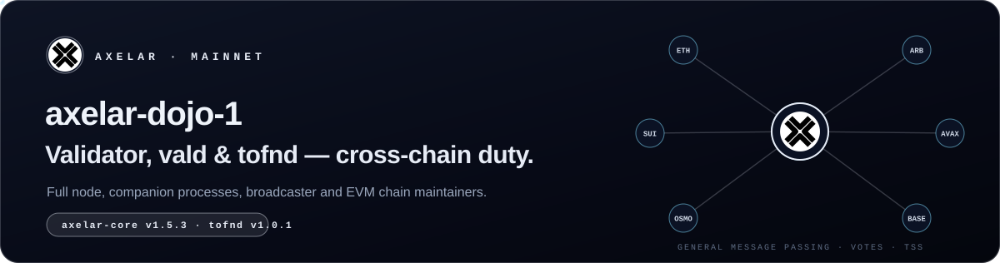
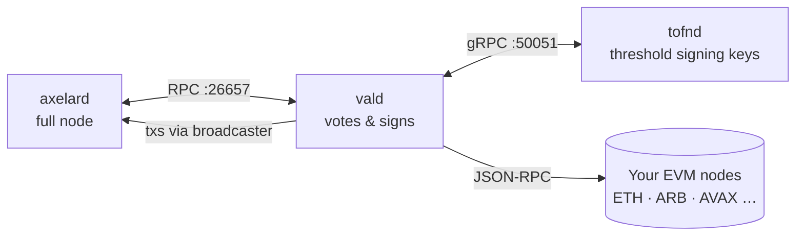

This is a runbook for **Axelar mainnet** (`axelar-dojo-1`). An Axelar validator is more than a signing node. It also runs two **companion processes**:

> [!NOTE]
> Checked on **2026-10-13** against the [Axelar docs](https://docs.axelar.dev/validator/setup/overview/), the [v1.5.3 mainnet upgrade notes](https://docs.axelar.dev/resources/mainnet/upgrades/v153/) and live chain parameters. Parts of the official manual-setup page still show older versions (v1.1.x), so this guide follows the v1.5.3 notes wherever they differ.

## 🗺️ The path

| Step | Guide | What you get |
|:---:|---|---|
| **01** | [Requirements & install](./01-requirements-install.md) | Server, firewall, `axelard` (static) and `tofnd` |
| **02** | [Full node](./02-full-node.md) | A synced `axelard` under systemd |
| **03** | [Validator](./03-validator.md) | tofnd + vald running, broadcaster registered, validator created |
| **04** | [External chains](./04-external-chains.md) | EVM RPCs wired into vald, chain-maintainer registration |
| **05** | [Maintenance](./05-maintenance.md) | Upgrades, health check, monitoring, migration |
| **06** | [Cheat sheet](./06-cheatsheet.md) | Every command on one page |

## 📋 Network parameters

| | |
|---|---|
| Chain ID | `axelar-dojo-1` |
| axelar-core | **`v1.5.3`** (v1.5 upgrade at height **33 625 777**, 2026-08-25) |
| tofnd | **`v1.0.1`** |
| Cosmos SDK / CometBFT / wasmvm | `v0.53` / `v0.38` / `v2.3.4` (bundled in the `-static` binary) |
| Home | `~/.axelar` (node) · `~/.tofnd` (tofnd) |
| Denom | `uaxl` (1 AXL = 1 000 000 uaxl), and the only fee denom allowed (`x/feepolicy`) |
| Gas price | `0.007uaxl` |
| Active set | **75** validators |
| Unbonding | 7 days |
| Downtime | Sign **≥ 50%** of a **94 426**-block window, or get jailed for **2 h** + 0.01% slash |
| Double sign | **2% slash** + tombstone |
| Broadcaster | Must hold **≥ 5 AXL**. The health check fails below that |
| Explorers | [Axelarscan](https://axelarscan.io) · [Mintscan](https://www.mintscan.io/axelar) · [Explorers.Guru](https://axelar.explorers.guru) |

<b>Public endpoints</b>

| RPC | gRPC |
|---|---|
| `https://axelar-rpc.polkachu.com` | `axelar-grpc.polkachu.com:15190` |
| `https://axelar-rpc.publicnode.com:443` | `axelar-grpc.qubelabs.io:9092` |
| `https://axelar-rpc.pops.one:443` | |

> [!TIP]
> Want to verify for Axelar's **Amplifier** chains too? That uses a separate process (`ampd`) and onboarding. See [Become a Verifier](https://docs.axelar.dev/validator/amplifier/verifier-onboarding/).

<a href="./01-requirements-install.md"><b>Start with step 01 →</b></a>

