[← 02 Install](./02-install-celestia-app.md) · **03 Consensus node** · [04 Validator →](./04-validator.md)

---

```bash
source $HOME/.celestia-env
```

## 1. Initialise

```bash
celestia-appd init "$MONIKER" --chain-id $CHAIN_ID --home $CELESTIA_HOME
```

## 2. Genesis

```bash
celestia-appd download-genesis $CHAIN_ID --home $CELESTIA_HOME
sha256sum $CELESTIA_HOME/config/genesis.json
```

Compare the result with the published genesis hash:

| Network | Genesis hash |
|---|---|
| `celestia` | `6BE39EFD10BA412A9DB5288488303F5DD32CF386707A5BEF33617F4C43301872` |
| `mocha-5` | `82DB3AC5AB8485E4784054BD10457533A64563F055C0D234A3134603A9C85D33` |

## 3. Seeds & peers

```bash
NET_URL=https://raw.githubusercontent.com/celestiaorg/networks/main/$CHAIN_ID

SEEDS=$(curl -sL $NET_URL/seeds.txt | tr '\n' ',' | sed 's/,$//')
sed -i -e "s|^seeds *=.*|seeds = \"$SEEDS\"|" $CELESTIA_HOME/config/config.toml

# optional: persistent peers
PEERS=$(curl -sL $NET_URL/peers.txt | tr '\n' ',' | sed 's/,$//')
sed -i -e "s|^persistent_peers *=.*|persistent_peers = \"$PEERS\"|" $CELESTIA_HOME/config/config.toml
```

Advertise your public address so other peers can dial you back:

```bash
EXT_IP=$(curl -s https://ifconfig.me)
sed -i -e "s|^external_address *=.*|external_address = \"$EXT_IP:26656\"|" $CELESTIA_HOME/config/config.toml
```

## 4. Configuration

Pick the profile for your node:

| Setting | File | Validator | RPC / pruned | Archival |
|---|---|---|---|---|
| `min-retain-blocks` | `app.toml` | `600000` | default `3000` | `0` |
| `pruning` | `app.toml` | `default` | `default` / `everything` | `nothing` |
| `indexer` | `config.toml` | `null` | `kv` if you query txs by hash | `kv` |

```bash
APP=$CELESTIA_HOME/config/app.toml
CFG=$CELESTIA_HOME/config/config.toml

# validator profile
sed -i -e "s|^min-retain-blocks *=.*|min-retain-blocks = 600000|" $APP
sed -i -e "s|^indexer *=.*|indexer = \"null\"|" $CFG

# application gRPC: Fibre and bridge nodes need it, and fresh configs ship it disabled
sed -i '/^\[grpc\]/,/^\[/ s|^enable *=.*|enable = true|'                  $APP
sed -i '/^\[grpc\]/,/^\[/ s|^address *=.*|address = "127.0.0.1:9090"|'    $APP

# CometBFT gRPC for bridge nodes (use 0.0.0.0 only if a bridge runs on another host)
sed -i '/^\[rpc\]/,/^\[/ s|^grpc_laddr *=.*|grpc_laddr = "tcp://127.0.0.1:9098"|' $CFG

# priv-validator gRPC for Fibre signing: a loopback IP literal, never "localhost"
sed -i -e 's|^priv_validator_grpc_laddr *=.*|priv_validator_grpc_laddr = "127.0.0.1:26669"|' $CFG

# metrics + quieter logs
sed -i -e 's|^prometheus *=.*|prometheus = true|' $CFG
sed -i -e 's|^log_level *=.*|log_level = "*:error,p2p:info,state:info"|' $CFG
```

> [!NOTE]
> On builds with celestia-core #3379, `localhost` **no longer counts as loopback** for `priv_validator_grpc_laddr`. Use `127.0.0.1:<port>` or `[::1]:<port>`. Older configs may use `26659` or leave the value empty, which disables the service. Fibre needs this endpoint.

> [!TIP]
> New nodes on v9+ use **PebbleDB** by default. If you are converting an old `goleveldb` node, stop it and run the `migrate-db` tool first.

## 5. Sync

Choose **one** of these:

<details open>
<summary><b>⚡ State sync</b> (~1 hour, no history)</summary>
<br>

You need **two RPC servers** that serve state-sync snapshots. For mainnet, [ITRocket](https://itrocket.net/services/mainnet/celestia/) publishes one.

```bash
RPC="https://<statesync-rpc-1>:443"
RPC2="https://<statesync-rpc-2>:443"

LATEST=$(curl -s $RPC/block | jq -r .result.block.header.height)
TRUST_HEIGHT=$((LATEST - 2000))
TRUST_HASH=$(curl -s "$RPC/block?height=$TRUST_HEIGHT" | jq -r .result.block_id.hash)
echo "$TRUST_HEIGHT $TRUST_HASH"

sed -i -E "/^\[statesync\]/,/^\[/ {
  s|^enable *=.*|enable = true|
  s|^rpc_servers *=.*|rpc_servers = \"$RPC,$RPC2\"|
  s|^trust_height *=.*|trust_height = $TRUST_HEIGHT|
  s|^trust_hash *=.*|trust_hash = \"$TRUST_HASH\"|
}" $CFG
```

Look for `Discovering snapshots` in the logs. Finding a snapshot can take a few minutes.
</details>

<details>
<summary><b>📦 Snapshot</b> (~5 hours)</summary>
<br>

[Qubelabs](https://snaps.qubelabs.io/celestia/) publishes snapshots. Check that one exists for your chain ID first. When this guide was written, no `mocha-5` snapshot was listed.

```bash
cd $HOME
rm -rf $CELESTIA_HOME/data && mkdir -p $CELESTIA_HOME/data
SNAP_NAME=$(curl -s https://snaps.qubelabs.io/celestia/ | egrep -o ">${CHAIN_ID}.*tar" | tr -d ">" | head -1)
echo "$SNAP_NAME"
aria2c -x 16 -s 16 -o celestia-snap.tar "https://snaps.qubelabs.io/celestia/${SNAP_NAME}"
tar xf celestia-snap.tar -C $CELESTIA_HOME/data/
rm celestia-snap.tar
```
</details>

<details>
<summary><b>🐢 From genesis</b> (slowest, full history)</summary>
<br>

Just start the node. Combine this with the archival profile above if you need complete history.
</details>

## 6. systemd

```bash
sudo tee /etc/systemd/system/celestia-appd.service > /dev/null <<EOF
[Unit]
Description=celestia-appd ($CHAIN_ID)
After=network-online.target
Wants=network-online.target

[Service]
User=$USER
ExecStart=$(which celestia-appd) start --home $CELESTIA_HOME
Restart=on-failure
RestartSec=5
LimitNOFILE=1048576

[Install]
WantedBy=multi-user.target
EOF

sudo systemctl daemon-reload
sudo systemctl enable --now celestia-appd
journalctl -u celestia-appd -f -o cat
```

## 7. Is it synced?

```bash
curl -s localhost:26657/status | jq '.result.sync_info | {latest_block_height, catching_up}'
curl -s localhost:26657/net_info | jq '.result.n_peers'
curl -s localhost:26657/abci_info | jq -r '.result.response.app_version'
```

`catching_up: false` means the node is synced. Don't create a validator before you see that.

---

[← 02 Install](./02-install-celestia-app.md) · **03 Consensus node** · [04 Validator →](./04-validator.md)
