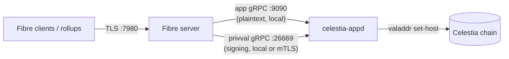

[← 04 Validator](./04-validator.md) · **05 Fibre** · [06 Maintenance →](./06-maintenance.md)

---

**Fibre** is the data availability service that arrived with **app version 10**. Clients upload and download blob shards directly from validator-run Fibre servers, and each server's storage budget comes from its validator's stake. Every bonded validator is expected to run one.



| | Mainnet `celestia` | Mocha `mocha-5` |
|---|---|---|
| Release | `v10.4.0` | `v10.4.0-mocha` |
| App v10 | ⏳ Signalling passed. Activates at height **15 116 658** (~2026-10-20 03:45 UTC) | ✅ Active |
| What to do | Have everything ready **before** the height. Start and register once `app_version` = 10 | Start and register now |

> [!IMPORTANT]
> **Installing the v10 binary does not activate v10.** Prepare binaries and config beforehand. Start Fibre and run `set-host` **only after** `app_version` reports `10`.

```bash
source $HOME/.celestia-env
```

## 1. Prerequisites checklist

- [ ] A synced validator in the **bonded** set ([step 04](./04-validator.md))
- [ ] `[grpc] enable = true`, `address = "127.0.0.1:9090"` in `app.toml`
- [ ] `priv_validator_grpc_laddr = "127.0.0.1:26669"` in `config.toml` (an IP literal, **not** `localhost`)
- [ ] A separate disk mounted for `$FIBRE_HOME`
- [ ] RAM headroom for the receive buffers (~27 GiB at default limits)
- [ ] glibc ≥ 2.34
- [ ] Port `7980/tcp` open to the internet
- [ ] If you use an external KMS: it supports `SignRawBytes` and has a median signing latency **≤ 10 ms**

The `app.toml` / `config.toml` lines were set in [step 03](./03-consensus-node.md#4-configuration). Restart celestia-appd after any change to them.

## 2. Install

```bash
cd $HOME
ARCH=$(uname -m); [ "$ARCH" = "aarch64" ] && ARCH=arm64
BASE="https://github.com/celestiaorg/celestia-app/releases/download/$APP_VERSION"

curl -fLO "$BASE/fibre_Linux_${ARCH}.tar.gz"
curl -fLO "$BASE/checksums.txt"
sha256sum --ignore-missing --check checksums.txt     # → OK

tar -xzf "fibre_Linux_${ARCH}.tar.gz"
sudo install -m 0755 fibre /usr/local/bin/fibre
rm -f "fibre_Linux_${ARCH}.tar.gz" checksums.txt
fibre version
```

<details>
<summary>Build from source instead</summary>

```bash
git clone --branch $APP_VERSION --depth 1 https://github.com/celestiaorg/celestia-app.git celestia-app-fibre
cd celestia-app-fibre
make build-fibre-server VERSION=$APP_VERSION
sudo install -m 0755 build/fibre /usr/local/bin/fibre
```
</details>

> [!NOTE]
> On mainnet, check the asset names on the [v10.4.0 release page](https://github.com/celestiaorg/celestia-app/releases/tag/v10.4.0). The archive pattern above is the one the Mocha docs use.

Prepare the data directory on the dedicated disk:

```bash
sudo mkdir -p $FIBRE_HOME && sudo chown -R $USER:$USER $FIBRE_HOME
```

Optionally, preview the config sync that v10 provides:

```bash
celestia-appd config sync --home $CELESTIA_HOME --fibre-home $FIBRE_HOME --dry-run
```

## 3. Wait for activation

```bash
curl -s http://127.0.0.1:26657/abci_info | jq -r '.result.response.app_version'
```

Continue only when this prints **`10`** or higher. The installed binary version does not prove that v10 is active.

## 4. systemd service

```bash
sudo tee /etc/systemd/system/fibre.service > /dev/null <<EOF
[Unit]
Description=Celestia Fibre server ($CHAIN_ID)
After=network-online.target celestia-appd.service
Wants=network-online.target

[Service]
User=$USER
ExecStart=$(which fibre) start \\
  --home $FIBRE_HOME \\
  --app-grpc-address 127.0.0.1:9090 \\
  --signer-grpc-address 127.0.0.1:26669 \\
  --server-listen-address 0.0.0.0:7980
Restart=on-failure
RestartSec=5
LimitNOFILE=1048576

[Install]
WantedBy=multi-user.target
EOF

sudo systemctl daemon-reload
sudo systemctl enable --now fibre
journalctl -u fibre -f -o cat
```

On first start, Fibre writes `$FIBRE_HOME/config/server_config.toml` with `app_grpc_address`, `signer_grpc_address` and `server_listen_address`. Flags override the file. **Unknown keys cause a startup error.**

In the startup log, check for the **chain ID**, the connected addresses and the storage backend.

### Connection limits

```toml
# $FIBRE_HOME/config/server_config.toml
max_connections = 16
max_concurrent_streams = 13
```

Memory ≈ `max_connections × max_concurrent_streams × 132 MiB`. A single upload can take all 16 default slots and block downloads. If you raise `max_connections`, recompute the RAM you need.

## 5. Register on-chain

Do this only once `<public_host>:7980` is reachable from the outside:

```bash
celestia-appd tx valaddr set-host <public_host>:7980 \
  --from $WALLET --chain-id $CHAIN_ID --keyring-backend $KEYRING_BACKEND $FEES -y
```

`host:port` takes an IP or DNS name, **with no scheme or path**.

```bash
VALCONS=$(celestia-appd comet show-address --home $CELESTIA_HOME)
celestia-appd query valaddr provider $VALCONS      # found: true, host matches
celestia-appd query valaddr providers
```

> [!NOTE]
> The registration persists. Run `set-host` again only if the address changes. The entry is **removed** if your validator leaves the active set, or stays jailed or unbonded for **more than 7 days**. Unregistered servers get no Fibre traffic.

## 6. Transport security

| Connection | Security |
|---|---|
| Clients → Fibre `:7980` | Always TLS. The certificate is endorsed by your **consensus key**, so you don't need a public certificate. |
| Fibre → app gRPC `:9090` | **Plaintext.** Keep it on the same host or a trusted private network. |
| Fibre → signer `:26669`, same host | Loopback IP literal, no TLS flags needed |
| Fibre → signer, remote host | **Mutual TLS is required.** Without it, the node refuses to start with a non-loopback signer address. |

<details>
<summary><b>Remote signer with mutual TLS</b></summary>
<br>

On Fibre, set all three flags together, or their `server_config.toml` equivalents:

```bash
--signer-grpc-ca-file   /etc/fibre/tls/server-ca.pem     # signer_grpc_ca_file
--signer-grpc-cert-file /etc/fibre/tls/fibre-client.pem  # signer_grpc_cert_file
--signer-grpc-key-file  /etc/fibre/tls/fibre-client.key  # signer_grpc_key_file
```

The node side needs a server certificate, its key and the client CA. See the [privval gRPC TLS guide](https://github.com/celestiaorg/celestia-core/blob/main/docs/guides/privval-grpc-tls.md).

> [!CAUTION]
> `--privval-grpc-allow-insecure` (node) and `--signer-grpc-allow-insecure` (Fibre) are for **local development only**. With them set, anyone who can reach the signer can get signatures from your validator key.
</details>

## 7. Object storage *(optional)*

Fibre can keep shards in S3-compatible storage (S3, R2) instead of the local disk. This needs `v10.4.0+`. Put the bucket in the same region as the host.

```toml
# $FIBRE_HOME/config/server_config.toml
storage_backend = "object"

[object_storage]
endpoint = "https://s3.us-east-1.amazonaws.com"   # R2: its S3 endpoint
region   = "us-east-1"                            # R2: "auto"
bucket   = "<bucket_name>"
prefix   = "fibre"
```

Credentials are read **only from environment variables**. Create the file private *before* you write the keys:

```bash
sudo install -d -m 0700 /etc/fibre
sudo install -m 0600 /dev/null /etc/fibre/s3.env
sudo nano /etc/fibre/s3.env
#   AWS_ACCESS_KEY_ID=...
#   AWS_SECRET_ACCESS_KEY=...

sudo mkdir -p /etc/systemd/system/fibre.service.d
printf "[Service]\nEnvironmentFile=/etc/fibre/s3.env\n" | sudo tee /etc/systemd/system/fibre.service.d/s3.conf
sudo systemctl daemon-reload && sudo systemctl restart fibre
```

The IAM permissions needed are `s3:GetObject`, `s3:PutObject`, `s3:DeleteObject` and `s3:ListBucket`.

> [!WARNING]
> Switching backends affects **new shards only**. Keep access to the old backend until its shards are pruned. If you change the endpoint, bucket, prefix, chain ID or validator, Fibre fails with `object namespace mismatch`. To migrate, stop Fibre, copy the objects with the same key layout, update the config, start once with `--override-object-namespace`, then remove the flag and restart.

## 8. Metrics

Fibre exports OTLP metrics to a collector such as Grafana Alloy or the OpenTelemetry Collector:

```bash
# add to ExecStart
--otel-endpoint http://localhost:4318
```

| Watch | Metric |
|---|---|
| Upload / download errors and latency | `fibre.server.upload_shard.duration`, `fibre.server.download_shard.duration` (`success` attribute) |
| Saturation | `fibre.server.upload_shard.in_flight`, `fibre.server.download_shard.in_flight` |
| Store I/O | `fibre.server.store.put.duration`, `fibre.server.store.get.duration` |
| Pruning | `fibre.server.prune.duration`, `fibre.server.prune.entries` |
| **Signing ≤ 10 ms** | `cometbft_privval_signing_latency_*` *(celestia-appd metric)* |

> [!TIP]
> The reference Docker Compose monitoring stack publishes Prometheus on **9090**, which collides with application gRPC. Remap it, for example to `9091:9090`. The release includes a Fibre Grafana dashboard, which expects a Prometheus data source with UID `prometheus`.

## 9. Troubleshooting

| Symptom | Fix |
|---|---|
| `unknown service cosmos.base.tendermint.v1beta1.Service` | Fibre is pointed at the wrong gRPC, or v10 isn't active yet |
| Missing Fibre / valaddr services | App v10 not active yet. Check `abci_info` |
| App gRPC connection refused | Enable `[grpc]` in `app.toml` and restart celestia-appd |
| Signer connection failed | The signer addresses don't match, the value is empty, or there's a port conflict. Use `127.0.0.1`, not `localhost` |
| `derived storage budget is 0` | The validator isn't bonded, or `--app-grpc-address` points at an unsynced or wrong network |
| Server runs but gets no uploads | Check `valaddr provider`, external reachability of `:7980`, and bonded status |
| `payment promise verification failed` | Usually a chain ID mismatch between Fibre and the client |
| TLS identity verification failed | The signer does not hold the validator's consensus key |
| Unknown field error | Remove the reported key from `server_config.toml` |
| `loading object storage credentials` | The env file or systemd drop-in is missing or wrong |

<sub>Sources: <a href="https://docs.celestia.org/operate/consensus-validators/fibre/">Run a Fibre server</a> · <a href="https://docs.celestia.org/operate/consensus-validators/fibre/metrics/">Fibre metrics</a> · <a href="https://github.com/celestiaorg/celestia-app/releases/tag/v10.4.0">v10.4.0 release notes</a></sub>

---

[← 04 Validator](./04-validator.md) · **05 Fibre** · [06 Maintenance →](./06-maintenance.md)
