[← 06 Maintenance](./06-maintenance.md) · **07 Cheat sheet** · [Celestia hub ↑](./README.md)

---

Every command assumes `source $HOME/.celestia-env` (see [step 01](./01-requirements.md#-pick-your-network)).

## 🩺 Node health

```bash
curl -s localhost:26657/status | jq '.result.sync_info | {latest_block_height, catching_up}'
curl -s localhost:26657/net_info | jq '.result.n_peers'
curl -s localhost:26657/abci_info | jq -r '.result.response.app_version'
curl -s localhost:26657/status | jq '.result.validator_info'
celestia-appd comet show-node-id --home $CELESTIA_HOME
celestia-appd comet show-address  --home $CELESTIA_HOME     # celestiavalcons…
```

## 📜 Services & logs

```bash
sudo systemctl restart celestia-appd
sudo systemctl status  celestia-appd
journalctl -u celestia-appd -f -o cat
journalctl -u celestia-appd --since "1 hour ago" | grep -iE "err|panic"

sudo systemctl restart fibre
journalctl -u fibre -f -o cat
```

## 👛 Wallet

```bash
celestia-appd keys list --keyring-backend $KEYRING_BACKEND
celestia-appd keys show $WALLET -a --keyring-backend $KEYRING_BACKEND
celestia-appd q bank balances $WALLET_ADDR
celestia-appd tx bank send $WALLET <to_address> 1000000utia \
  --chain-id $CHAIN_ID --keyring-backend $KEYRING_BACKEND $FEES -y
```

## 🛡️ Validator

```bash
# create (validator.json, see step 04)
celestia-appd tx staking create-validator $HOME/validator.json --from $WALLET \
  --chain-id $CHAIN_ID --keyring-backend $KEYRING_BACKEND $FEES -y

celestia-appd q staking validator $VALOPER
celestia-appd q slashing signing-info $(celestia-appd comet show-validator --home $CELESTIA_HOME)

celestia-appd tx slashing unjail --from $WALLET --chain-id $CHAIN_ID \
  --keyring-backend $KEYRING_BACKEND $FEES -y

celestia-appd tx distribution withdraw-rewards $VALOPER --commission --from $WALLET \
  --chain-id $CHAIN_ID --keyring-backend $KEYRING_BACKEND $FEES -y

celestia-appd tx staking delegate $VALOPER 1000000utia --from $WALLET \
  --chain-id $CHAIN_ID --keyring-backend $KEYRING_BACKEND $FEES -y
```

## 🧵 Fibre

```bash
celestia-appd query valaddr provider $(celestia-appd comet show-address --home $CELESTIA_HOME)
celestia-appd query valaddr providers

celestia-appd tx valaddr set-host <public_host>:7980 --from $WALLET \
  --chain-id $CHAIN_ID --keyring-backend $KEYRING_BACKEND $FEES -y

nc -vz <public_host> 7980          # run from another machine
fibre version

# health (v10.5.0+): exit 0 = SERVING
grpc_health_probe -addr=127.0.0.1:7980 -tls -tls-no-verify                          # readiness
grpc_health_probe -addr=127.0.0.1:7980 -tls -tls-no-verify -service=fibre-liveness   # liveness
journalctl -u fibre -o cat | grep -E "health check failed|server not ready" | tail
```

## 🗳️ Governance & upgrades

```bash
celestia-appd q gov proposals --proposal-status voting-period
celestia-appd tx gov vote <id> yes --from $WALLET --chain-id $CHAIN_ID \
  --keyring-backend $KEYRING_BACKEND $FEES -y          # yes | no | no_with_veto | abstain

celestia-appd tx signal signal <version> --from $WALLET --chain-id $CHAIN_ID \
  --keyring-backend $KEYRING_BACKEND $FEES -y
celestia-appd query signal tally <version>
celestia-appd query signal missing-validators <version>
celestia-appd query signal upgrade
```

> [!TIP]
> Does your governance record hold up? Check where your validator ranks on the [MushCrypto Governance Scorecard](https://mushcrypto.world/scorecard/).

## 🔌 Ports at a glance

| `26656` | `26657` | `9090` | `9098` | `26669` | `26660` | `7980` |
|---|---|---|---|---|---|---|
| P2P 🌍 | RPC 🔒 | app gRPC 🔒 | core gRPC 🔒 | signer 🔒 | metrics 🔒 | Fibre 🌍 |

## 📁 Files that matter

| Path | What |
|---|---|
| `$CELESTIA_HOME/config/priv_validator_key.json` | 🔑 consensus key, **never run it in two places** |
| `$CELESTIA_HOME/data/priv_validator_state.json` | last signed height/round, carry it with the key |
| `$CELESTIA_HOME/config/node_key.json` | P2P identity |
| `$CELESTIA_HOME/config/config.toml` | CometBFT: P2P, RPC, signer address, Prometheus |
| `$CELESTIA_HOME/config/app.toml` | app: gRPC, pruning, `min-retain-blocks` |
| `$FIBRE_HOME/config/server_config.toml` | Fibre: addresses, limits, storage backend |
| `$HOME/validator.json` | create-validator parameters: moniker, commission, self-delegation |

---

[← 06 Maintenance](./06-maintenance.md) · **07 Cheat sheet** · [Celestia hub ↑](./README.md)


