  
  

This is a complete runbook for **Celestia consensus operators**. It covers everything from a bare server to a signing validator with a registered Fibre server. Every guide works on both networks: you set `CHAIN_ID` once and copy-paste the rest.

> [!NOTE]
> Versions were checked on **2026-10-29** against the [official Celestia docs](https://docs.celestia.org) and the [celestia-app releases](https://github.com/celestiaorg/celestia-app/releases).

 

## 🗺️ The path

| Step | Guide | What you get |
|:---:|---|---|
| **01** | [Requirements](./01-requirements.md) | A server that passes the bar, with the toolchain, BBR, firewall and network variables set up |
| **02** | [Install celestia-app](./02-install-celestia-app.md) | The `celestia-appd` multiplexer binary, at the right version for your network |
| **03** | [Consensus node](./03-consensus-node.md) | A synced full node running under systemd |
| **04** | [Validator](./04-validator.md) | A bonded validator, with keys backed up and slashing risks understood |
| **05** | [Fibre server](./05-fibre.md) | Fibre running next to your validator, registered on-chain *(app v10+)* |
| **06** | [Maintenance](./06-maintenance.md) | Upgrades and signalling, monitoring, migration and resets |
| **07** | [Cheat sheet](./07-cheatsheet.md) | Every command on one page |

> [!TIP]
> Running a **light, bridge or full storage DA node** instead? Our [Node Docs](https://mushcrypto.world/docs/) cover the `celestia-node` side.

 

## Mainnet Beta

| | |
|---|---|
| Chain ID | `celestia` |
| celestia-app | **`v10.5.0`** (multiplexer. Minor, non-consensus-breaking update over v10.4.0) |
| celestia-node | `v0.34.4` |
| App version 10 / Fibre | ✅ **Active** since height **15 116 658** (2026-10-20 03:45 UTC). Bonded validators run a [Fibre server](./05-fibre.md) |
| Genesis hash | `6BE39EFD10BA412A9DB5288488303F5DD32CF386707A5BEF33617F4C43301872` |
| Genesis / peers | [`networks/celestia`](https://github.com/celestiaorg/networks/tree/main/celestia) |
| Validators | 100 |
| Explorers | [Celenium](https://celenium.io) · [Mintscan](https://mintscan.io/celestia) · [Explorers.Guru](https://celestia.explorers.guru) · [ITRocket](https://mainnet.itrocket.net/celestia/) |
| Snapshots / state sync | [Qubelabs snapshots](https://snaps.qubelabs.io/celestia/) · [ITRocket state sync](https://itrocket.net/services/mainnet/celestia/) |
| Status | [status.celestia.dev](https://status.celestia.dev/status/mainnet) |

<b>Community endpoints</b> (fine for testing, not for production)

| Provider | RPC | gRPC |
|---|---|---|
| P-OPS | `https://rpc.celestia.pops.one` | `grpc.celestia.pops.one` |
| ITRocket | `https://celestia-mainnet-rpc.itrocket.net:443` | `celestia-mainnet-grpc.itrocket.net:443` |
| kjnodes | `https://celestia.rpc.kjnodes.com` | `celestia.grpc.kjnodes.com:443` |
| Numia | `https://public-celestia-rpc.numia.xyz` | `public-celestia-grpc.numia.xyz` |

The full list is in the [official docs](https://docs.celestia.org/operate/networks/mainnet-beta/).

 

## Mocha testnet

| | |
|---|---|
| Chain ID | `mocha-5` (a new chain that started at height 1. It is a hard spoon of mocha-4 at block 13205115, so balances carried over but validators did not) |
| celestia-app | **`v10.5.0-mocha`** (minor, non-consensus-breaking update over v10.4.0-mocha) |
| celestia-node | `v0.34.4-mocha` |
| App version 10 / Fibre | ✅ Active |
| Genesis hash | `82DB3AC5AB8485E4784054BD10457533A64563F055C0D234A3134603A9C85D33` |
| Genesis / seeds / peers | [`networks/mocha-5`](https://github.com/celestiaorg/networks/tree/main/mocha-5) |
| Validators | 100 (max) |
| Faucet | [mocha.celenium.io/faucet](https://mocha.celenium.io/faucet) · Discord `#mocha-faucet`: `$request <address>` |
| Explorers | [Celenium](https://mocha.celenium.io) · [Mintscan](https://mintscan.io/celestia-testnet) · [Explorers.Guru](https://testnet.celestia.explorers.guru) · [ITRocket](https://testnet.itrocket.net/celestia) |

<b>Community endpoints</b>

| Provider | RPC | gRPC |
|---|---|---|
| P-OPS | `https://rpc-mocha.pops.one` | `grpc-mocha.pops.one` |
| Nodes.Guru | `https://rpc-1.testnet.celestia.nodes.guru` | `grpc-1.testnet.celestia.nodes.guru:10790` |
| ITRocket | `https://celestia-testnet-rpc.itrocket.net:443` | `celestia-testnet-grpc.itrocket.net:443` |

The full list is in the [official docs](https://docs.celestia.org/operate/networks/mocha-testnet/).

> [!WARNING]
> **mocha-4 is legacy** and was shut down on 2026-09-01. Many explorers and old guides still point to it. Anything that says `mocha-4`, or `celestia-app` below v10, is out of date for Mocha.

 

<a href="./01-requirements.md"><b>Start with step 01: Requirements →</b></a>

