[← 04 Maintenance](./04-maintenance.md) · **05 Cheat sheet** · [Shentu hub ↑](./README.md)

---

Every command assumes `source $HOME/.shentu-env`.

## 🩺 Node

```bash
curl -s localhost:26657/status | jq '.result.sync_info | {latest_block_height, catching_up}'
curl -s localhost:26657/net_info | jq '.result.n_peers'
curl -s localhost:26657/status | jq '.result.validator_info'
shentud version
journalctl -u shentud -f -o cat
sudo systemctl restart shentud
```

## 👛 Wallet

```bash
shentud keys list --keyring-backend $KEYRING_BACKEND
shentud q bank balances $WALLET_ADDR
shentud tx bank send $WALLET <to> 1000000uctk --chain-id $CHAIN_ID \
  --keyring-backend $KEYRING_BACKEND $GAS -y
```

## 🛡️ Validator

```bash
shentud tx staking create-validator $HOME/validator.json --from $WALLET \
  --chain-id $CHAIN_ID --keyring-backend $KEYRING_BACKEND $GAS -y

shentud q staking validator $VALOPER
shentud q slashing signing-info $(shentud comet show-validator --home $DAEMON_HOME)

shentud tx slashing unjail --from $WALLET --chain-id $CHAIN_ID \
  --keyring-backend $KEYRING_BACKEND $GAS -y

shentud tx distribution withdraw-rewards $VALOPER --commission --from $WALLET \
  --chain-id $CHAIN_ID --keyring-backend $KEYRING_BACKEND $GAS -y
```

## 🗳️ Governance & upgrades

```bash
shentud q gov proposals --proposal-status voting-period
shentud tx gov vote <id> yes --from $WALLET --chain-id $CHAIN_ID \
  --keyring-backend $KEYRING_BACKEND $GAS -y
shentud q upgrade plan
```

## 📁 Files

| Path | What |
|---|---|
| `~/.shentud/config/priv_validator_key.json` | 🔑 consensus key |
| `~/.shentud/data/priv_validator_state.json` | last signed height |
| `~/.shentud/config/app.toml` | gas price, pruning |
| `~/.shentud/config/config.toml` | P2P, RPC, state sync, Prometheus |
| `$HOME/validator.json` | create-validator parameters |

---

[← 04 Maintenance](./04-maintenance.md) · **05 Cheat sheet** · [Shentu hub ↑](./README.md)


