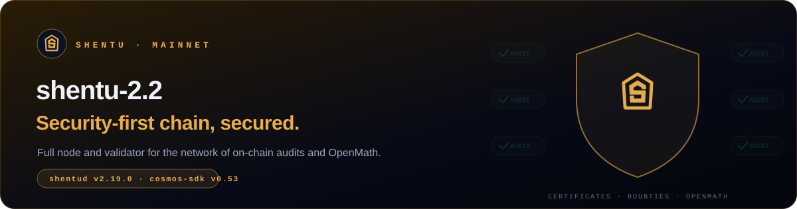

This is a runbook for **Shentu mainnet** (`shentu-2.2`). It takes you from a bare server to a signing validator.

> [!NOTE]
> Checked on **2026-10-29** against [shentufoundation/shentu releases](https://github.com/shentufoundation/shentu/releases), the [mainnet repo](https://github.com/shentufoundation/mainnet) and live chain parameters (the network runs `v2.20.0`).

## 🗺️ The path

| Step | Guide | What you get |
|:---:|---|---|
| **01** | [Requirements & install](./01-requirements-install.md) | Server, firewall, the `shentud` binary, network variables |
| **02** | [Full node](./02-full-node.md) | A synced node under systemd |
| **03** | [Validator](./03-validator.md) | A bonded validator created from `validator.json` |
| **04** | [Maintenance](./04-maintenance.md) | Upgrades, monitoring, migration |
| **05** | [Cheat sheet](./05-cheatsheet.md) | Every command on one page |

## 📋 Network parameters

| | |
|---|---|
| Chain ID | `shentu-2.2` |
| Binary | `shentud`, **`v2.20.0`** (mandatory upgrade at block 31 812 210, 2026-10-29) |
| Cosmos SDK / CometBFT | `v0.53.8` / `v0.38` |
| Go (source builds) | 1.23 |
| Home | `~/.shentud` |
| Denom | `uctk` (1 CTK = 1 000 000 uctk) |
| Gas price | `0.025uctk` (chain-registry average) |
| Active set | **125** validators |
| Unbonding | 21 days |
| Downtime | Sign **≥ 10%** of a **10 000**-block window, or get jailed for 10 min + 0.01% slash |
| Double sign | **5% slash** + tombstone |
| Genesis | [`mainnet/shentu-2.2/genesis.json`](https://raw.githubusercontent.com/shentufoundation/mainnet/main/shentu-2.2/genesis.json) |
| Snapshots | [Polkachu](https://polkachu.com/tendermint_snapshots/shentu) |
| Explorers | [Mintscan](https://www.mintscan.io/shentu) · [ping.pub](https://ping.pub/shentu) · [Shentu explorer](https://explorer.shentu.org/?chain=shentu-2.2) |

<b>Public endpoints</b>

| RPC | gRPC |
|---|---|
| `https://rpc.shentu.org:443` | `grpc.shentu.org:443` |
| `https://shentu-rpc.polkachu.com` | `shentu-grpc.polkachu.com:14090` |

<a href="./01-requirements-install.md"><b>Start with step 01 →</b></a>

